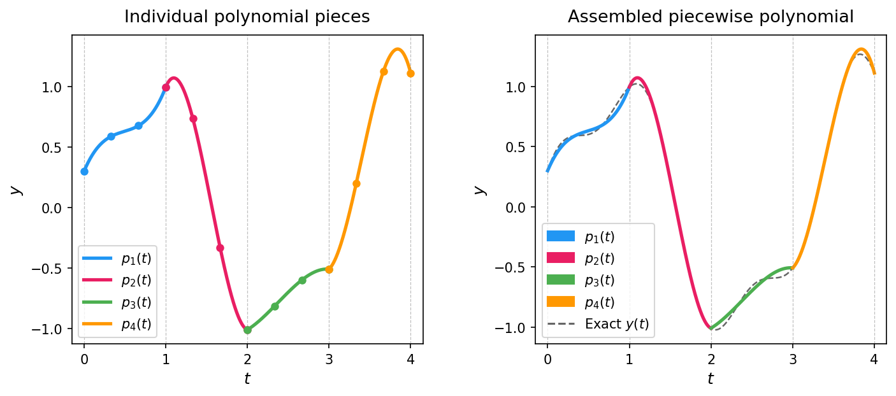

# voles

[](https://github.com/trout314/voles/actions/workflows/tests-linux.yml)
[](https://github.com/trout314/voles/actions/workflows/tests-macos.yml)
[](https://github.com/trout314/voles/actions/workflows/tests-windows.yml)
[](https://www.gnu.org/licenses/gpl-3.0)
[](https://www.python.org)
[](https://trout314.github.io/voles/)

<p align="center">
  
</p>

The Volterra Equation Solvers (VOLES) package is a collection of fast collocation-method solvers for Volterra integral and integro-differential equations. All solvers support real- and complex-valued data, scalar-, vector-, and matrix-valued equations, and (with callable inputs) weakly singular kernels. The algorithms used come from the book

> Brunner H. *Collocation Methods for Volterra Integral and Related Functional Differential Equations.* Cambridge University Press; 2004.

The solvers are implemented as a compiled extension written in the [D language](https://dlang.org). Performance should be on par with optimized C or FORTRAN code. Currently, only convolution type kernels are supported, but this restriction is likely to be lifted in a future version.

## Solvers

One solver per equation. Each takes its inputs in either of two forms:

- **arrays** of samples on a uniform time grid, with spacing `dt`. The fastest path when the data are already sampled (measured or simulated);
- **callables** `kernel(u)`, `g(t)`, `a(t)`, solved on a mesh of breakpoints you choose (`mesh=`). This form also handles weakly singular kernels.

All three return a `VolterraSolution`: the solution on the input grid (`sol.t`, `sol.y`), a callable piecewise polynomial `sol(t)` for any t in $[0, T]$, and the collocation data.

### Type-1 Volterra integral equation (VIE-1)

Given functions $K$ and $g$, solve for the unknown function $y(t)$ in:

$$g(t) = \int_0^t K(t-s)\\, y(s)\\, ds$$

Solver: `solve_vie1` ([API reference](https://trout314.github.io/voles/api/vie1/)).

### Type-2 Volterra integral equation (VIE-2)

Given functions $K$ and $g$, solve for the function $y(t)$ in:

$$y(t) = g(t) + \int_0^t K(t-s)\\, y(s)\\, ds$$

Solver: `solve_vie2` ([API reference](https://trout314.github.io/voles/api/vie2/)).

### Volterra integro-differential equation (VIDE)

Given functions $K$, $a$, $g$, and initial value $y(0)$, solve for the function $y(t)$ in:

$$y'(t) = a(t)\\, y(t) + g(t) + \int_0^t K(t-s)\\, y(s)\\, ds$$

Solver: `solve_vide` ([API reference](https://trout314.github.io/voles/api/vide/)).

### Mesh helper: `optimal_graded_mesh`

For a kernel with a weak singularity at zero, $K(u) \sim u^{-\alpha}$ with known $\alpha \in [0, 1)$. Returns the graded mesh $t_n = T (n/M)^r$, $n = 0, \ldots, M$, with grading exponent $r = p / (1 - \alpha)$, where $p$ (`order`) should be the number of collocation nodes. Pass it as `mesh=` with callable inputs, and declare the singularity with `kernel_singularity={0.0: alpha}`, to get the method's full convergence order. (For $\alpha = 0$ it returns a uniform mesh.) Declaring the exponent, not just the location (`kernel_singularity=0.0`), is also much faster: the blocks the singularity touches use Gauss–Jacobi rules instead of adaptive quadrature. Together with a kernel that accepts arrays, the solve is 9–16× faster in the [benchmarks](https://trout314.github.io/voles/benchmarks/).

API reference: [api/optimal_graded_mesh/](https://trout314.github.io/voles/api/optimal_graded_mesh/)

> **Upgrading from 0.10?** The six 0.10 functions (`solve_VIE_1`, …, `function_solve_VIDE`) still work in 0.11 with a `DeprecationWarning` that shows the equivalent new call; they are removed in 1.0. See [Migration from 0.10](https://trout314.github.io/voles/guide/migration/).

## Installation

<!-- --8<-- [start:install] -->
```bash
pip install voles[full]
```

This gives you the fully-capable package, so everything just works out of the box. Pre-built wheels are provided for Linux x86_64, macOS arm64 (Apple Silicon), and Windows x64. The D extension is bundled in the wheel and requires no extra tooling. Intel Macs are no longer supported as of 0.3.2; users can pin to `volterra-equation-solvers==0.3.1` or build from source (see [CONTRIBUTING.md](https://github.com/trout314/voles/blob/main/CONTRIBUTING.md)).

**Requirements:** Python ≥ 3.10, numpy, scipy

**If you have trouble installing a dependency**, you can use a slimmer install instead. `numba` and `scipy` are only needed for some features (see below), so any of these will still give you a working package:

```bash
pip install voles          # core: numpy + scipy (no numba)
pip install voles --no-deps && pip install numpy   # leanest: numpy only, no scipy or numba
```

**What the optional pieces buy you:**
- `scipy` (core dependency) — required for callable inputs and for `VolterraSolution.to_ppoly()`.
- `numba` (added by `[full]`) — only needed for sampled inputs with `quadrature="collocation"` and a collocation setting not compiled into the D extension; the default product quadrature needs neither.

To build from source (e.g. on an unsupported platform), see [CONTRIBUTING.md](https://github.com/trout314/voles/blob/main/CONTRIBUTING.md).
<!-- --8<-- [end:install] -->

> 📊 **Performance:** asymptotic complexity is summarized [below](#benchmarks); detailed measured timings live in the [benchmarks page of the docs](https://trout314.github.io/voles/benchmarks/).

## Quick start

```python
import numpy as np
import voles

# y(t) = sin(t) satisfies this VIE-2 with K(u) = exp(-u)
dt = 0.05
t = np.arange(0, 2.1, dt)   # 42 samples
g = np.sin(t) - 0.5*(np.exp(-t) + np.sin(t) - np.cos(t))

sol = voles.solve_vie2(kernel=np.exp(-t), g=g, dt=dt)
print(f"Max error: {np.max(np.abs(sol.y - np.sin(t))):.2e}")
print(f"y(1.234) = {sol(1.234):.6f}, exact {np.sin(1.234):.6f}")
```

The same problem with callables, on a mesh of your choice:

```python
import numpy as np
import voles

sol = voles.solve_vie2(kernel=lambda u: np.exp(-u),
                       g=lambda t: np.sin(t) - 0.5*(np.exp(-t) + np.sin(t) - np.cos(t)),
                       mesh=np.linspace(0, 2, 21))
print(f"y(1.234) = {sol(1.234):.6f}")
```

Sampled inputs may have any length that covers at least one mesh interval: when the samples don't end on a mesh point, the last interval is stretched (to at most twice the regular width) to absorb the leftovers, keeping the convergence order. The [Conventions](https://trout314.github.io/voles/guide/conventions/) page has the full rules: regimes, shapes, collocation settings and evaluation.

## The solution object

`VolterraSolution` holds the piecewise polynomial: `sol(t)` evaluates it anywhere in $[0, T]$ (NaN outside), `sol.y` holds its values on the input grid `sol.t`, `sol.node_values` the collocation values, and `sol.coefficients` each interval's polynomial. `sol.to_ppoly()` returns it as a `scipy.interpolate.PPoly`, for derivatives, integrals and roots. See [Working with the solution](https://trout314.github.io/voles/examples/polynomial_solutions/).

## Vector and Matrix Valued Equations

All solvers can solve for vector-valued and matrix-valued functions $y(t)$. When $y(t)$ is a $d$-dimensional vector, $g(t)$ is also a $d$-dimensional vector and $K(t)$ and $a(t)$ are $d \times d$ matrices. When $y(t)$ is a $d \times m$ matrix — $m$ right-hand sides solved together — $g(t)$ or $y(0)$ is a $d \times m$ matrix; an input without the column axis is shared by all $m$ columns. The case is detected from the shapes of the arrays, or of the callables' return values. The kernel's work is shared across the $m$ columns, so a matrix solve is much cheaper than $m$ separate calls.

See the worked examples: [vector- and matrix-valued equations](https://trout314.github.io/voles/examples/matrix_vector/).

## Complex-Valued Equations

Pass complex arrays (or callables returning complex values) for the kernel, forcing function, and (for the VIDE) initial value, and the solution is complex. This works for scalar, vector, and matrix cases alike. See the [complex-valued equations example](https://trout314.github.io/voles/examples/complex/).

## How the Collocation Method Works

The solvers approximate each component of $y(t)$ as a piecewise polynomial. The time axis is divided into mesh intervals, and on each interval the solution is represented by a polynomial whose coefficients are determined by requiring the Volterra equation to hold exactly at a set of collocation points within that interval.

Because the solution on each mesh interval is an explicit polynomial, it can be evaluated at arbitrary times, differentiated, integrated, and so on (see The solution object above).

## Piecewise Polynomial Illustration

The figure below shows an actual `voles` solution to a first-kind VIE ($g(t) = \sin t$, $K(s) = e^{s}$, exact solution $y(t) = \cos t - \sin t$). The time axis is split into mesh intervals at breakpoints $t_0, \ldots, t_4$ (dashed vertical lines); on each interval the solver finds a polynomial $p_i(t)$ that satisfies the equation at a set of collocation points (dots). A deliberately coarse mesh is used so the structure is visible: the pieces are **discontinuous across interval boundaries** — first-kind collocation does not enforce continuity by default — and visibly deviate from the exact solution (dashed). Refining the mesh shrinks both the jumps and the error.



## Benchmarks

**Sampled inputs.** On the uniform grid the history sums are accumulated with a blocked-FFT scheme (Hairer–Lubich–Schlichte), so the runtime is quasilinear — not quadratic — in the number of input points N; d is the number of rows in the solution and m the number of columns:

| | Scalar | Vector (d×1) | Matrix (d×m)* |
|---|---|---|---|
| Time | O(N log² N) | O(N log² N · d²) | O(N log² N · d² m) |
| Memory | O(N) | O(N d²) | O(N d² m) |

\* The m columns of the solution are independent and run in parallel threads (capped at the CPU count).

The collocation setting (`coll_setting`) affects the constant factor but not the asymptotic scaling in N, d, and m.

**Callable inputs.** With M mesh intervals and p collocation nodes per interval, the precomputed weight tensor couples every interval pair, so time and memory scale as O(M² p² d²). On a *uniform* mesh with a convolution kernel the tensor is Toeplitz and is assembled from a single integrated row, reducing the number of numerical integrations — the dominant cost in practice — from O(M²) to O(M); declaring a power-law singularity with the dict form of `kernel_singularity` keeps this fast path for singular kernels too, and on any mesh replaces adaptive quadrature in the singular blocks with Gauss–Jacobi rules (typically 3–10× faster).

**Measured timings** for both kinds of input (regenerated automatically on each push) live on the [benchmarks page of the documentation](https://trout314.github.io/voles/benchmarks/).

See the [Getting Started](https://trout314.github.io/voles/getting_started/) page for complete examples.

Worked derivations of the analytic solutions used in the test suite are in [`docs/scalar_solutions.pdf`](docs/scalar_solutions.pdf) and [`docs/coupled_vector_solutions.pdf`](docs/coupled_vector_solutions.pdf).
